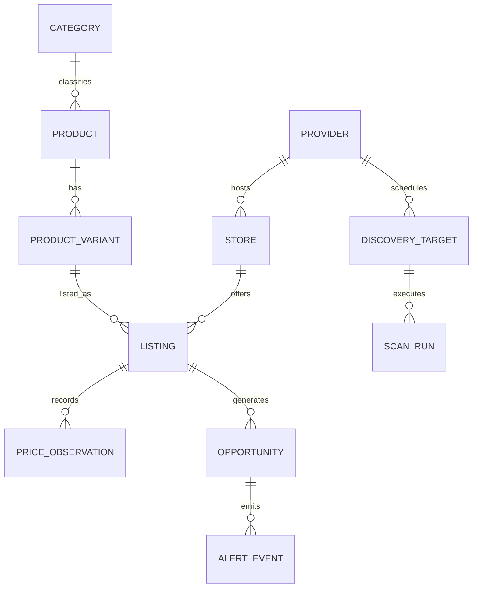

# PriceRadar — Normalized PostgreSQL Data Model

## 1. Entity-Relationship Overview

---

## 2. Core Entities & Schema Specification (Neon PostgreSQL + Drizzle ORM)

All monetary columns (`*_cop`) use ` integer` (`INT4` or `BIGINT` in PostgreSQL) representing whole Colombian Pesos (`COP`). All timestamps use `TIMESTAMPTZ`.

### 2.1 `providers`

- `id` (`TEXT PRIMARY KEY`) — e.g., `'fixture-colombia'`
- `display_name` (`TEXT NOT NULL`)
- `is_simulated_fixture` (`BOOLEAN NOT NULL DEFAULT false`)
- `capabilities_json` (`JSONB NOT NULL`)
- `status` (`TEXT NOT NULL`) — `'ACTIVE' | 'BLOCKED' | 'DISABLED'`
- `created_at`, `updated_at` (`TIMESTAMPTZ NOT NULL`)

### 2.2 `stores`

- `id` (`UUID PRIMARY KEY`)
- `provider_id` (`TEXT NOT NULL REFERENCES providers(id)`)
- `external_store_id` (`TEXT NOT NULL`)
- `name` (`TEXT NOT NULL`)
- `category_slug` (`TEXT NOT NULL`)
- **Unique Constraint:** `UNIQUE (provider_id, external_store_id)`

### 2.3 `categories`

- `slug` (`TEXT PRIMARY KEY`) — e.g., `'supermercado'`, `'tecnologia'`, `'electrohogar'`
- `name_es_co` (`TEXT NOT NULL`)
- `parent_slug` (`TEXT REFERENCES categories(slug)`)

### 2.4 `products`

- `id` (`UUID PRIMARY KEY`)
- `provider_id` (`TEXT NOT NULL REFERENCES providers(id)`)
- `external_product_id` (`TEXT NOT NULL`)
- `category_slug` (`TEXT NOT NULL REFERENCES categories(slug)`)
- `name` (`TEXT NOT NULL`)
- `brand` (`TEXT NOT NULL`)
- **Unique Constraint:** `UNIQUE (provider_id, external_product_id)`

### 2.5 `product_variants`

- `id` (`UUID PRIMARY KEY`)
- `product_id` (`UUID NOT NULL REFERENCES products(id)`)
- `external_variant_id` (`TEXT NOT NULL`)
- `packaging_label` (`TEXT NOT NULL`) — e.g., `'Bolsa 500 g en grano'`
- `unit_quantity` (`INTEGER NOT NULL`)
- `unit_type` (`TEXT NOT NULL`) — `'g' | 'ml' | 'unit' | 'kg' | 'l'`
- `image_url` (`TEXT`)
- `product_url` (`TEXT NOT NULL`)
- **Unique Constraint:** `UNIQUE (product_id, external_variant_id)`

### 2.6 `listings`

Represents a specific `ProductVariant` offered by a specific `Store` in a specific `city_slug`.

- `id` (`UUID PRIMARY KEY`)
- `canonical_listing_key` (`TEXT NOT NULL UNIQUE`)
- `store_id` (`UUID NOT NULL REFERENCES stores(id)`)
- `variant_id` (`UUID NOT NULL REFERENCES product_variants(id)`)
- `country_code` (`CHAR(2) NOT NULL DEFAULT 'CO'`)
- `city_slug` (`TEXT NOT NULL`)
- `city_name` (`TEXT NOT NULL`)
- `zone_code` (`TEXT`)
- `current_price_cop` (`INTEGER NOT NULL CHECK (current_price_cop >= 0)`)
- `declared_reference_price_cop` (`INTEGER CHECK (declared_reference_price_cop >= 0)`)
- `historical_low_cop` (`INTEGER NOT NULL`)
- `historical_median_cop` (`INTEGER NOT NULL`)
- `observation_count` (`INTEGER NOT NULL DEFAULT 1`)
- `availability` (`TEXT NOT NULL`)
- `provenance` (`TEXT NOT NULL`) — `'DEMO_FIXTURE' | 'LIVE_PROVIDER'`
- `first_observed_at` (`TIMESTAMPTZ NOT NULL`)
- `last_observed_at` (`TIMESTAMPTZ NOT NULL`)
- **Unique Constraint:** `UNIQUE (store_id, variant_id, city_slug)`
- **Indexes:** `idx_listings_city_availability (city_slug, availability)`, `idx_listings_last_observed (last_observed_at DESC)`

### 2.7 `price_observations`

- `id` (`UUID PRIMARY KEY`)
- `listing_id` (`UUID NOT NULL REFERENCES listings(id) ON DELETE CASCADE`)
- `scan_run_id` (`TEXT NOT NULL`)
- `idempotency_key` (`TEXT NOT NULL UNIQUE`)
- `observed_price_cop` (`INTEGER NOT NULL CHECK (observed_price_cop >= 0)`)
- `declared_reference_price_cop` (`INTEGER`)
- `availability` (`TEXT NOT NULL`)
- `provenance` (`TEXT NOT NULL`)
- `observed_at` (`TIMESTAMPTZ NOT NULL`)
- `last_verified_at` (`TIMESTAMPTZ NOT NULL`)
- **Indexes:** `idx_observations_listing_time (listing_id, observed_at DESC)`

### 2.8 `discovery_targets`

- `id` (`TEXT PRIMARY KEY`)
- `provider_id` (`TEXT NOT NULL REFERENCES providers(id)`)
- `store_id` (`TEXT NOT NULL`)
- `category_slug` (`TEXT NOT NULL`)
- `city_slug` (`TEXT NOT NULL`)
- `enabled` (`BOOLEAN NOT NULL DEFAULT true`)
- `priority` (`INTEGER NOT NULL DEFAULT 50`)
- `pagination_cursor` (`TEXT`)
- `last_scan_at` (`TIMESTAMPTZ`)
- **Indexes:** `idx_targets_eligible (enabled, priority ASC, last_scan_at ASC NULLS FIRST)`

### 2.9 `scan_runs`

- `scan_run_id` (`TEXT PRIMARY KEY`)
- `started_at` (`TIMESTAMPTZ NOT NULL`)
- `completed_at` (`TIMESTAMPTZ`)
- `status` (`TEXT NOT NULL`) — `'RUNNING' | 'SUCCEEDED' | 'PARTIAL' | 'FAILED' | 'SKIPPED_LOCKED'`
- `targets_attempted` (`INTEGER NOT NULL`)
- `targets_completed` (`INTEGER NOT NULL`)
- `listings_discovered` (`INTEGER NOT NULL`)
- `observations_persisted` (`INTEGER NOT NULL`)
- `opportunities_created` (`INTEGER NOT NULL`)
- `is_partial_coverage` (`BOOLEAN NOT NULL`)
- `error_summary` (`TEXT`)

### 2.10 `opportunities`

- `id` (`UUID PRIMARY KEY`)
- `opportunity_key` (`TEXT NOT NULL UNIQUE`)
- `listing_id` (`UUID NOT NULL REFERENCES listings(id) ON DELETE CASCADE`)
- `type` (`TEXT NOT NULL`) — `'DECLARED_DISCOUNT' | 'HISTORICAL_DROP' | 'HISTORICAL_LOW' | 'POTENTIAL_ANOMALY'`
- `status` (`TEXT NOT NULL DEFAULT 'ACTIVE'`) — `'ACTIVE' | 'EXPIRED' | 'SUPPRESSED'`
- `observed_price_cop` (`INTEGER NOT NULL`)
- `baseline_price_cop` (`INTEGER NOT NULL`)
- `savings_cop` (`INTEGER NOT NULL`)
- `discount_basis_points` (`INTEGER NOT NULL`)
- `historical_observation_count` (`INTEGER NOT NULL`)
- `confidence` (`TEXT NOT NULL`) — `'LOW' | 'MEDIUM' | 'HIGH'`
- `requires_verification` (`BOOLEAN NOT NULL`)
- `rationale_es_co` (`TEXT NOT NULL`)
- `provenance` (`TEXT NOT NULL`)
- `detected_at` (`TIMESTAMPTZ NOT NULL`)
- `expires_at` (`TIMESTAMPTZ`)
- **Indexes:** `idx_opportunities_public_feed (status, provenance, detected_at DESC, discount_basis_points DESC)`

### 2.11 `alert_events`

- `id` (`UUID PRIMARY KEY`)
- `opportunity_id` (`UUID NOT NULL REFERENCES opportunities(id) ON DELETE CASCADE`)
- `channel` (`TEXT NOT NULL`) — `'INTERNAL_LOG' | 'WEBHOOK'`
- `dispatched_at` (`TIMESTAMPTZ NOT NULL`)
- `delivery_status` (`TEXT NOT NULL`)

### 2.12 `admin_users`

- `id` (`UUID PRIMARY KEY`)
- `auth_subject_id` (`TEXT NOT NULL UNIQUE`)
- `email` (`TEXT NOT NULL UNIQUE`)
- `role` (`TEXT NOT NULL CHECK (role IN ('OWNER', 'ADMIN'))`)
- `active` (`BOOLEAN NOT NULL DEFAULT true`)
- `created_at` (`TIMESTAMPTZ NOT NULL`)
