# PriceRadar — Architecture Overview

## 1. System Purpose

PriceRadar is an automated price intelligence platform for the Colombian market (`es-CO`, `COP`). Rather than relying on manual user watchlists, PriceRadar explores configured store/category targets automatically, normalizes product variants, records historical price observations in integer Colombian Pesos (`COP`), and applies deterministic statistical rules to surface:

- **Descuento anunciado (`DECLARED_DISCOUNT`)** — Retailer-advertised reference discount (flagged as unverified against history unless supported by prior observations).
- **Bajada de precio (`HISTORICAL_DROP`)** — Verified decline relative to PriceRadar's own historical median for that exact store, variant, and city.
- **Mínimo registrado (`HISTORICAL_LOW`)** — Lowest observed price in PriceRadar's dataset with sufficient observation history.
- **Posible error de precio (`POTENTIAL_ANOMALY`)** — Deep statistical deviation (`>= 45%` below historical median across `>= 5` prior observations) requiring manual verification.

---

## 2. Monorepo Topology

```text
priceradar/
├── apps/
│   ├── web/                # Next.js 15 App Router public dashboard & private admin (Port 4178)
│   └── worker/             # Standalone CLI discovery & price intelligence worker (no HTTP server)
├── packages/
│   ├── config/             # Shared runtime constants, port policy, and worker bounds
│   ├── domain/             # Framework-independent entities, integer COP math,es-CO strings, intelligence rules
│   ├── providers/          # Capability-aware CatalogProvider contract + FixtureCatalogProvider
│   ├── database/           # Normalized repository interfaces, in-memory store, and Neon Drizzle boundaries
│   └── ui/                 # Shared design tokens and visual primitives
├── scripts/
│   └── check-port.mjs      # Safe port 4178 preflight & port policy enforcement
└── docs/                   # Engineering documentation (English)
```

### Dependency Direction Rules

- `@priceradar/domain` and `@priceradar/config` have **zero internal workspace dependencies**.
- `@priceradar/providers` and `@priceradar/database` depend only on `@priceradar/domain`.
- `apps/worker` and `apps/web` compose `@priceradar/domain`, `@priceradar/providers`, `@priceradar/database`, and `@priceradar/config`.
- Circular dependencies are strictly prohibited.

---

## 3. End-to-End Discovery Data Flow

```mermaid
flowchart LR
  Scheduler["GitHub Actions Cron (15m) / CLI"] --> Worker["@priceradar/worker"]
  Worker --> Lock["Acquire Execution Lock"]
  Lock --> Targets["Select Eligible DiscoveryTargets"]
  Targets --> Provider["CatalogProvider.discover()"]
  Provider --> Normalize["Normalize & Validate Integer COP"]
  Normalize --> History["Fetch Prior Observations (Exclude Current)"]
  History --> PersistObs["Idempotent Observation Persistence"]
  PersistObs --> Rules["Price Intelligence Engine (@priceradar/domain)"]
  Rules --> PersistOpp["Deduplicate & Save Opportunities"]
  PersistOpp --> Web["Next.js Public Dashboard (Port 4178)"]
```



---

## 4. Key Architectural Invariants

1. **Integer Monetary Arithmetic:** All Colombian Peso (`COP`) amounts are validated via `createCopAmount()` as non-negative safe integers (`CopAmount`). Discounts are calculated in integer basis points (`1% = 100 bps`).
2. **Store & Variant Isolation:** Canonical listing keys (`providerId::storeId::productId::variantId::citySlug`) guarantee that a `250 g` variant is never compared against a `500 g` variant, and prices from different stores or cities are never conflated.
3. **Historical Baseline Purity:** `evaluateListingOpportunities()` strictly excludes observations sharing the current `sourceObservedAt` timestamp or newer timestamps.
4. **Honest Provenance & Freshness:** Every observation and opportunity carries a `DataProvenance` (`DEMO_FIXTURE` vs `LIVE_PROVIDER`). Simulated data is always labeled `"Datos de demostración"` in the UI.
5. **Strict Local Port Isolation:** All web dev, preview, and E2E tasks run exclusively on port `4178` (`127.0.0.1:4178`), guarded by `scripts/check-port.mjs`.
