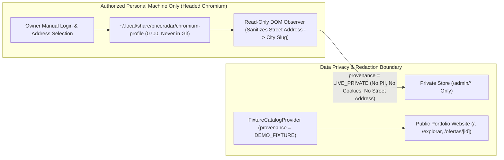

# Provider Feasibility Research — Rappi Colombia (Public SSR & Authenticated Browser Assessment)

**Date:** 2026-11-07  
**Target Market:** Colombia (`es-CO`, integer `COP`)  
**Primary Use Case:** Strictly personal, non-commercial shopping price discovery for the owner's own consumption (`alejandrowp3`) scoped to the owner's saved delivery address, keeping all real collected pricing data private (`LIVE_PRIVATE`) while the public portfolio website displays deterministic demo data (`DEMO_FIXTURE`).

---

## 1. Executive Feasibility Verdict Matrix

We separate **Technical Capability**, **Contractual/Permission Status**, and **Operational Execution Environment** across the evaluated integration modes:

| Integration Mode / Capability                                                                     | Verdict              | Justification                                                                                                                                                                                                                                                                                                                                                                                                                                                                                                                                                                                                    |
| ------------------------------------------------------------------------------------------------- | -------------------- | ---------------------------------------------------------------------------------------------------------------------------------------------------------------------------------------------------------------------------------------------------------------------------------------------------------------------------------------------------------------------------------------------------------------------------------------------------------------------------------------------------------------------------------------------------------------------------------------------------------------- |
| **1. Public Republication of Collected Rappi Data**                                               | **`BLOCKED`**        | Rappi's Colombian Terms of Use (`rappi.com.co/terminos-y-condiciones`) grant access strictly for personal, non-commercial use and reserve all database and IP rights. Live Rappi data must never be served on public unauthenticated pages or committed to the public Git repository.                                                                                                                                                                                                                                                                                                                            |
| **2. Unauthenticated Generic City Routes (e.g., `/bogota/supermercados`)**                        | **`BLOCKED`**        | Empirical HTTP `GET` returned `HTTP 404` with `0` products and `0` prices; `robots.txt` disallows `/api`, `/api-services`, and `/base-api`.                                                                                                                                                                                                                                                                                                                                                                                                                                                                      |
| **3. Unauthenticated Pre-Rendered Storefront Pages (`/tiendas/tipo/market` & `/tiendas/{slug}`)** | **`CONDITIONAL GO`** | Empirical HTTP `GET` (`HTTP 200`) exposes `~105` products per store home page in `__NEXT_DATA__` and JSON-LD, anchored to the store's default SEO branch (`Medellín — El Poblado`), **but** cannot reflect the owner's exact saved street address or paginate beyond initial SSR corridors without an active address session.                                                                                                                                                                                                                                                                                    |
| **4. Owner-Authenticated, Headed Playwright Browser Observation (Personal Address Context)**      | **`CONDITIONAL GO`** | **Technically Feasible (`GO`):** A visible Chromium session where the owner manually logs in and selects their saved delivery address renders exact branch-scoped product cards, integer `COP` prices, discounts, packaging, and stock in the DOM. **Contractually/Operationally Conditional (`CONDITIONAL GO`):** Requires manual owner login outside agent control, local user-directory profile storage (never in Git or GitHub Actions), zero CAPTCHA/WAF bypass, and execution only on an authorized personal machine (not unattended background automation on the corporate Mac or GitHub-hosted runners). |
| **5. Automated Headless Browser Execution on GitHub Actions (`ubuntu-latest`)**                   | **`BLOCKED`**        | Requires uploading personal session cookies/tokens to cloud secrets, triggers geo-IP/ASN mismatches (Azure US/global datacenter IP vs. Colombian residential session), risks account security locks/OTP challenges, and cannot support interactive manual login or headed inspection.                                                                                                                                                                                                                                                                                                                            |
| **6. `FixtureCatalogProvider` (`fixture-colombia`) for Public Portfolio**                         | **`GO`**             | Implemented and verified in Phase 0. Powers the public read-only portfolio dashboard (`/`, `/explorar`, `/ofertas/[id]`) with deterministic Colombian product trajectories explicitly badged `"Datos de demostración"`.                                                                                                                                                                                                                                                                                                                                                                                          |

---

## 2. Authenticated Browser Feasibility Assessment (`F001` Deep Dive)

### 2.1 Technical Feasibility of Authenticated Browser Observation

When a consumer logs into `https://www.rappi.com.co` in an ordinary Chromium browser and selects a saved delivery address in their account:

1. **Delivery Context Resolution:**
   - The web application binds the active delivery address (city, neighborhood, and exact coordinates) to the user's browser session and resolves the specific dark store or supermarket fulfillment branch serving that address.
   - The selected address label is visibly rendered in the top header bar of the interface, allowing a read-only DOM observer to verify that the active delivery context matches expectations without logging or persisting raw street coordinates.
2. **DOM-Level Product & Price Rendering:**
   - Navigating to a supermarket storefront or category corridor within that visible browser session renders standard HTML DOM product cards and hydrated Next.js state containing all required PriceRadar fields for the exact store branch serving the owner's address.
3. **Read-Only DOM Observation (No Private API Reverse-Engineering):**
   - Using Playwright's standard DOM locators (`page.locator(...)` / `locator.evaluateAll(...)`) or reading standard `<script type="application/ld+json">` / `#__NEXT_DATA__` nodes present in the document requires **zero** direct calls to `/api`, `/api-services`, or `/base-api`, and **zero** mobile-app impersonation.

### 2.2 Contractual & Permission Status (Separated from Technical Capability)

We explicitly distinguish what is **technically possible** in Chromium from what is **contractually permitted** under `rappi.com.co/terminos-y-condiciones`:

| Dimension                                               | Status                                | Detailed Analysis                                                                                                                                                                                                                                                                                                                                                                                                                                                                                                                                |
| ------------------------------------------------------- | ------------------------------------- | ------------------------------------------------------------------------------------------------------------------------------------------------------------------------------------------------------------------------------------------------------------------------------------------------------------------------------------------------------------------------------------------------------------------------------------------------------------------------------------------------------------------------------------------------ |
| **Personal, Non-Commercial Motive**                     | **Aligned**                           | Rappi's consumer license explicitly authorizes platform access on the user's personal device for **personal, non-commercial use** (_"exclusivamente para su uso personal, no comercial"_). Using a browser on your own account to check discounts for your own household shopping does not violate the non-commercial clause.                                                                                                                                                                                                                    |
| **Account Credential & Session Security**               | **Permitted if Manual**               | The owner logging into their own account manually in a standard Chromium window (handling any OTP/2FA personally) uses the platform's intended authentication flow. Conversely, sharing credentials with third-party services or scripting credential/OTP bypasses is prohibited.                                                                                                                                                                                                                                                                |
| **DOM Observation via Playwright vs. Anti-Bot Clauses** | **Uncertain / Grey Area**             | Consumer Terms reserve all rights not expressly granted and prohibit unauthorized automated extraction, spiders, or reverse-engineering. While **interactive, user-initiated, read-only DOM inspection** of pages the user is actively viewing in their own browser closely mirrors a personal browser extension (e.g., accessibility readers or personal price trackers), **unattended high-frequency background crawling** (even from a personal account) is **not expressly authorized** and could trigger account rate limits or suspension. |
| **Public Redistribution of Observed Data**              | **Explicitly Prohibited (`BLOCKED`)** | All intellectual property and database rights belong exclusively to Rappi. Any prices observed in an authenticated browser session must remain strictly private to the owner (`LIVE_PRIVATE`) and must never be published on the public portfolio website or committed to Git.                                                                                                                                                                                                                                                                   |

---

## 3. Required Product Fields & Availability in Rendered Interface

In an authenticated Chromium session with a selected Colombian delivery address, the rendered storefront interface exposes all 7 required fields:

| #   | Required Field                              | Availability in Rendered DOM / Page State | Extraction Mechanism (Read-Only DOM)                                                                                                                                                                                                   |
| --- | ------------------------------------------- | ----------------------------------------- | -------------------------------------------------------------------------------------------------------------------------------------------------------------------------------------------------------------------------------------- |
| 1   | **Product Identity**                        | **Available**                             | Product permalink href (`/p/{slug}-{id}`), `data-*` attributes, or `#__NEXT_DATA__` product `id` / `master_product_id` / `ean`.                                                                                                        |
| 2   | **Product Name & Brand**                    | **Available**                             | Product card heading / title element (`h2`/`h3`/`span` product title) and brand label (`trademark`).                                                                                                                                   |
| 3   | **Current Price & Reference Price (`COP`)** | **Available**                             | Rendered integer `COP` price text (e.g., `$ 31.500`) and strikethrough reference price (`real_price`), parsed into validated `CopAmount` integers.                                                                                     |
| 4   | **Store Identity**                          | **Available**                             | Storefront header title and URL slug (`/tiendas/{storeId}-{slug}`), scoped to the branch serving the active delivery address.                                                                                                          |
| 5   | **Variant / Packaging**                     | **Available**                             | Rendered unit/presentation subtitle (e.g., `500 g`, `1000 ml`, `Unidad`) and PUM (_Precio por Unidad de Medida_, e.g., `($ 63/g)`).                                                                                                    |
| 6   | **Availability**                            | **Available**                             | Presence of active "Agregar" / add-to-cart control vs. "Agotado" / out-of-stock badge (only visible cards in stock are eligible for opportunities).                                                                                    |
| 7   | **Canonical Product URL**                   | **Available**                             | Anchor `href` pointing to `https://www.rappi.com.co/p/...`.                                                                                                                                                                            |
| 8   | **Geographic Relevance**                    | **Available (Owner's Saved Address)**     | Directly governed by the delivery address selected by the owner in the authenticated header bar; mapped in PriceRadar to an abstract city/zone slug (e.g., `medellin` or `bogota`) without storing the owner's private street address. |

---

## 4. Session Persistence Architecture & Risk Analysis

### 4.1 Persistent Context vs. Ephemeral Context

- **Recommended Pattern (`launchPersistentContext` outside the repo):**
  - Playwright's `chromium.launchPersistentContext(userDataDir, { headless: false })` uses a dedicated local Chromium profile directory stored **outside** the Git repository, e.g.:
    ```text
    ~/.local/share/priceradar/chromium-profile/   (chmod 0700)
    ```
  - **Bootstrap Flow (Manual Owner Login):**
    1. Owner runs a manual bootstrap command that opens a visible Chromium window pointed at `https://www.rappi.com.co`.
    2. Owner logs in personally (OTP / passkey / email) and selects their desired saved delivery address in the Rappi header.
    3. No passwords, OTP codes, cookies, or tokens are ever typed into the CLI, logged to stdout, or read by the agent.
    4. Chromium naturally persists its own encrypted session cookies/IndexedDB inside `~/.local/share/priceradar/chromium-profile/`.
- **Why `storageState.json` Export Is Avoided:**
  - Exporting `context.storageState({ path: "auth.json" })` writes plaintext session cookies and localStorage tokens to a JSON file, creating a high risk of accidental file exposure. Keeping session state inside an OS-protected `0700` browser profile directory outside the workspace (and explicitly blocking `*.har`, `.auth/`, `.playwright-profile/`, and `*storage-state*.json` in `.gitignore`) is significantly safer.

### 4.2 Session Risks & Failure Modes

1. **Session Expiration & Re-Authentication:** Consumer web sessions expire periodically or when security tokens rotate. If a session expires, the observer must **never** attempt automated login; it must halt immediately with `AUTH_REQUIRED` and prompt the owner to log in manually in headed mode.
2. **Account-Level Rate Limiting / Anti-Bot Detection:** Even in a real Chromium browser, rapid automated page navigation can trigger Cloudflare Turnstile, CAPTCHA, or account flags. The workflow must strictly forbid automated CAPTCHA solving, Stealth plugins, or concurrent tabs.

---

## 5. Data Privacy, Security & Credential Isolation Design



1. **Address & PII Sanitization at Ingestion:**
   - The DOM observer must **never** read, log, or persist the owner's street address, apartment number, phone number, email, or account name.
   - Before constructing a `DiscoveredListing`, geographic metadata is mapped strictly to a coarse city/zone identifier (e.g., `{ countryCode: "CO", citySlug: "medellin", cityName: "Medellín" }`).
2. **Strict Separation of `LIVE_PRIVATE` vs. `DEMO_FIXTURE`:**
   - Public routes (`/`, `/explorar`, `/ofertas/[id]`, `/estadisticas`, `/como-funciona`) query **only** `provenance = 'DEMO_FIXTURE'`.
   - Any `LIVE_PRIVATE` observations are accessible exclusively in `/admin/*` behind server-enforced authentication.
3. **Repository & Log Hygiene:**
   - `.gitignore` explicitly blocks `.playwright-profile/`, `.auth/`, `*.har`, and `*storage-state*.json`.
   - Zero cookies, `Authorization` headers, or `Set-Cookie` values are ever printed to console or stored in `scan_runs`.

---

## 6. Headed vs. Headless & Hosting / Scheduling Constraints

### 6.1 Headed vs. Headless Execution Comparison

| Criterion                                    | Headed Chromium (`headless: false`)                                                | Headless Chromium (`headless: true`)                                                              |
| -------------------------------------------- | ---------------------------------------------------------------------------------- | ------------------------------------------------------------------------------------------------- |
| **Manual Owner Login & Address Selection**   | **Supported** (Owner interacts directly with the visible browser window).          | **Impossible** (Owner cannot complete interactive login/OTP or visually confirm address).         |
| **WAF / Behavioral Fingerprinting Risk**     | **Lower** (Standard desktop GPU/window rendering matching normal user browsing).   | **High** (Headless browser signals frequently trigger Cloudflare/WAF challenges on retail sites). |
| **Visibility & Control (Stop on Challenge)** | **High** (Owner can immediately see and close the browser if a challenge appears). | **Opaque** (Fails silently or hits challenges in background).                                     |
| **Suitability for PriceRadar**               | **Required for Browser-Assisted Workflow**                                         | **Not Recommended for Rappi**                                                                     |

### 6.2 GitHub Actions vs. Corporate Mac vs. Authorized Personal Machine

| Environment                                               | Suitability for Authenticated Browser Workflow       | Operational & Security Constraint                                                                                                                                                                                                                                                       |
| --------------------------------------------------------- | ---------------------------------------------------- | --------------------------------------------------------------------------------------------------------------------------------------------------------------------------------------------------------------------------------------------------------------------------------------- |
| **GitHub Actions (`ubuntu-latest`)**                      | **`BLOCKED`**                                        | Cannot run interactive headed login; requires uploading personal session cookies to cloud secrets; runs from datacenter IPs that mismatch the owner's Colombian residential session and trigger WAF/account locks. (GitHub Actions should only run `DEMO_FIXTURE` or public open APIs). |
| **Current Corporate Mac (`~/Developer/priceradar`)**      | **`RESTRICTED` (No Persistent Personal Automation)** | This Mac is a corporate-managed machine. Do **not** install persistent background `launchd`/`cron` jobs for personal Rappi automation or store long-lived personal consumer sessions without explicit policy clearance.                                                                 |
| **Authorized Personal Machine (On-Demand / Interactive)** | **`CONDITIONAL GO`**                                 | Running an on-demand, owner-supervised headed browser check (`pnpm worker:scan:browser`) on an authorized personal environment where the owner manually logs in and triggers a bounded read-only observation pass.                                                                      |

---

## 7. Phase P1 — Empirical Results & Security/Geographic Corrections (`F-P1-01`, `F-P1-02`)

In **Phase P1**, PriceRadar implemented and verified the standalone supervised browser inspector (`pnpm rappi:inspect`) across `packages/providers/src/rappi-browser-inspector.ts` and `apps/worker/src/rappi-inspect-cli.ts`.

### 7.1 `F-P1-01` — Keyed HMAC-SHA256 Context Privacy & Secret Rotation

- **Replacement of Unkeyed SHA-256:** Unkeyed SHA-256 over `(citySlug, normalizedAddress)` is vulnerable to offline dictionary guessing against known urban street/neighborhood names. `computePrivacyPreservingContextHash` now enforces **Keyed HMAC-SHA256** (`crypto.createHmac("sha256", contextHmacSecret)`) over `priceradar-hmac-v2::${citySlug}::${normalizedLabel}` to produce `ctx-<16hex>`.
- **Strict Secret Validation:** `validateContextHmacSecret` requires at least `32` bytes (`MIN_CONTEXT_HMAC_SECRET_BYTES = 32`) of high-entropy secret material and rejects empty, short, low-entropy, or `.env.example` placeholder strings. It never falls back to an unkeyed hash.
- **Stability Across Restarts:** `resolveOrProvisionContextHmacSecret` reads `PRICERADAR_CONTEXT_HMAC_SECRET` or (on an authorized personal machine when `--persist-authorized-personal-profile` is passed) loads/provisions `~/.local/share/priceradar/context-hmac.key` (`0600` permissions inside a `0700` directory).
- **Secret Rotation & History Migration (`PRICERADAR_PREVIOUS_CONTEXT_HMAC_SECRET`):**
  1. Set the new key in `PRICERADAR_CONTEXT_HMAC_SECRET` and move the old key to `PRICERADAR_PREVIOUS_CONTEXT_HMAC_SECRET`.
  2. During the next supervised inspection, `computeKeyedContextIdentifiersWithRotation` derives both `fulfillmentContextHash` (new key) and `previousFulfillmentContextHash` (old key) in memory from the active header and immediately discards the raw address.
  3. Pass `{ fromContextHash: previousFulfillmentContextHash, toContextHash: fulfillmentContextHash }` to `migrateObservationsForRotatedContext(observations, migration)` to rewrite existing historical `listingKey` and `observationId` records without ever storing or exposing the raw address.

### 7.2 `F-P1-02` — 5-Layer Actual Fulfillment-Context Validation

An active delivery header alone does **not** prove that rendered product prices correspond to the selected delivery address. `validateGeographicDeliveryContext` and `inspectStorefrontSnapshot` evaluate 5 explicit layers in `geographicValidation.evidenceBreakdown`:

1. **`activeAddressSelection`:** `VERIFIED_ACTIVE_SELECTION` | `PLACEHOLDER_OR_EMPTY` | `MISSING_HEADER_SELECTOR`
2. **`cityAndNeighborhoodMetadata`:** `VERIFIED_FROM_ACTIVE_CONTEXT` | `STATIC_SEO_METADATA_ONLY` | `MISSING`
3. **`servingStoreBranch`:** `VERIFIED_BRANCH_SERVING_CONTEXT` | `UNVERIFIED_STATIC_DEFAULT_BRANCH` | `MISSING`
4. **`productCatalogContext`:** `VERIFIED_CONTEXT_BOUND_CATALOG` | `UNVERIFIED_RENDERED_DOM_CATALOG` | `UNVERIFIED_STATIC_SEO_HYDRATION` | `EMPTY_CATALOG`
5. **`pricingVerificationVerdict`:** `VERIFIED_ADDRESS_SPECIFIC_PRICING` | `UNVERIFIED_STATIC_SEO_PRICING` | `UNVERIFIED_BRANCH_OR_CATALOG_ASSOCIATION` | `UNVERIFIED_MISSING_HMAC_SECRET` | `UNVERIFIED_NO_ACTIVE_ADDRESS`

If an active address is selected in the header (`activeAddressSelection === "VERIFIED_ACTIVE_SELECTION"`), but the product catalog comes from `#__NEXT_DATA__` SSR hydration (`UNVERIFIED_STATIC_SEO_HYDRATION`) or lacks verified serving-branch and context-bound catalog association (`UNVERIFIED_BRANCH_OR_CATALOG_ASSOCIATION`), `isDeliveryContextVerified` remains `false`, `gateStatus` returns `"UNVERIFIED_FULFILLMENT_CONTEXT"`, and `listings` is empty (`[]`). Address-specific pricing is only declared verified when all 5 layers are satisfied.
